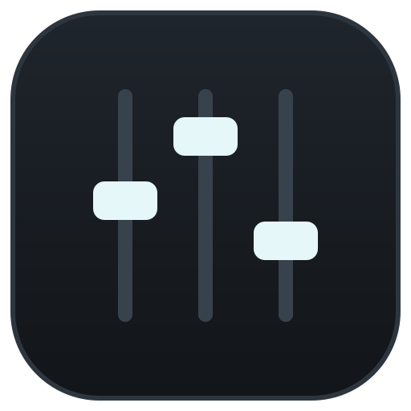

<div align="center">



# dB-Deck

**A free, open-source audio mixer for Windows.**
Per-app volume, unlimited channels and buses, real audio routing.

[Download](https://github.com/Maxdemyd0/dB-Deck/releases/latest) · [Features](#features) · [Switching from Voicemeeter](#switching-from-voicemeeter) · [Build](#building-from-source)

</div>

---

dB-Deck combines the simplicity of the Windows Volume Mixer with Voicemeeter-style routing. Add an app, move its fader, and you're done. When you need more, add mixes for your stream or a virtual mic for Discord, and process your microphone. You aren't limited to a fixed number of strips or buses.

No account. No subscription. No telemetry.

## Features

- **Per-app volume.** Apps that are playing sound appear in *Available Apps*; add them with one click. Channels remember their apps and reconnect when an app restarts.
- **Choose each app's output device**, the same as the Windows Volume Mixer setting, from the app's channel menu.
- **Unlimited channels and buses.** Send any input to any number of buses, each at its own level (pre- or post-fader), and chain buses into each other.
- **Real audio engine.** A native C++ engine (WASAPI, 48 kHz, 32-bit float) captures microphones, playback devices and individual apps, and mixes them with low latency.
- **Faders up to +20 dB**, plus mute, solo, balance, groups and live meters. Click any level to type an exact value, scroll in 1 dB steps (Ctrl for 0.1 dB), and clip lights stay lit until you clear them.
- **Global hotkeys.** Mute your mic, hold-to-mute, nudge a volume, switch scenes or profiles, even in a game or with dB-Deck in the tray.
- **Undo and redo** for every mixer change, including fader moves. Deleting something shows an Undo button.
- **Your layout, your way.** Rename, color and reorder channels and buses; right-click any strip for its menu.
- **Effects.** EQ, noise gate, compressor, limiter and gain, applied to the actual audio.
- **Main output stays where you put it.** It plays on the device you choose, independent of the Windows default, reconnects automatically, and only falls back to devices you approve.
- **Windows volume sync.** The toolbar's Windows volume follows Quick Settings and your keyboard volume keys, and moving it changes Windows' volume too.
- **Profiles and scenes.** Switch whole setups, or swap levels instantly.
- **Import from Voicemeeter.** Turns your Voicemeeter Standard, Banana or Potato settings into a dB-Deck profile. If Voicemeeter is still running and holding a device, dB-Deck tells you and can close it for you.
- **Runs in the tray.** Closing the window keeps audio running. It can start with Windows.
- **Safe by design.** It rejects routing loops and feedback, and never plays a captured app twice on the same device.

## Install

1. Download `dB-Deck_1.0.0_x64-setup.exe` from the [latest release](https://github.com/Maxdemyd0/dB-Deck/releases/latest).
2. Run it. It installs for your user only, so no administrator rights are needed.

Windows SmartScreen may warn that the publisher is unknown, because the installer isn't code-signed yet. Choose **More info › Run anyway**.

**Requirements:** Windows 11, 64-bit (tested). Windows 10 version 2004 or later should work but hasn't been tested.

## Getting started

1. Open dB-Deck and pick your speakers or headphones as **Main** in the toolbar.
2. Click **+** next to an app in **Available Apps** to control its volume.
3. Use **Add channel** for a microphone, or to capture a playback device.
4. Switch to the **Mixer** or **Advanced** view for buses, sends, effects and the routing matrix.

### Virtual microphone (Discord, OBS, …)

dB-Deck's own virtual-device driver isn't signed yet (see [Status](#status)). Meanwhile, use the free, Microsoft-signed [VB-CABLE](https://vb-audio.com/Cable/):

1. Install VB-CABLE.
2. In dB-Deck, create a bus (for example *Discord Mic*), set its output to **CABLE Input**, and send your mic and any apps to it.
3. In Discord or OBS, choose **CABLE Output** as the microphone.

## Switching from Voicemeeter

1. **Profiles › Import from Voicemeeter.** dB-Deck reads your latest Voicemeeter settings and builds the same routing: your inputs, the Voicemeeter virtual inputs your apps already play to, and your A outputs. It tells you what it couldn't carry over.
2. Point each former **B** output (virtual mic) at a VB-CABLE, as described above.
3. Close Voicemeeter, remove it from startup, and load the imported profile.

Your apps keep playing to the same devices, so nothing else needs changing.

## Status

dB-Deck **1.0.0** is the first public release. Tested on real hardware so far:

- Per-app volume
- Capture and playback through the engine (measured playback latency about 23 ms)
- Windows volume sync
- VB-CABLE routing
- The Voicemeeter import

Known limitations:

- **No own virtual devices yet.** The included virtual cable driver (`driver/windows`) builds but is only test-signed. Using it needs Windows test mode with Secure Boot off, so for now use VB-CABLE.
- **Some things haven't been tested on real hardware yet:** unplugging and reconnecting devices, sleep and resume, and per-app capture with every kind of app.
- **The installer isn't code-signed.**

See [docs/TESTING.md](docs/TESTING.md) for exactly what has been verified, and [docs/HANDOFF.md](docs/HANDOFF.md) for open issues.

## Building from source

**Requirements:**
- Visual Studio 2022 or newer with the C++ workload (MSVC, CMake, Ninja)
- Windows SDK
- Rust (stable, MSVC)
- Node.js 20+

```bash
scripts\build-release.cmd
```

This builds and tests the engine, then produces the installer in `apps/desktop/src-tauri/target/release/bundle/nsis/`.

For development:

```bash
scripts\build-engine.cmd Release
```

```bash
cd apps/desktop && npm install && npx tauri dev
```

To build the optional driver (requires the Windows Driver Kit; builds only, installs nothing):

```bash
scripts\build-driver.cmd
```

### Tests

```bash
build\engine-Release\dbdeck-tests.exe
```

```bash
build\engine-Release\dbdeck-wintests.exe
```

```bash
cd apps/desktop && npx vitest run
```

The Windows integration tests use real audio devices. See [docs/TESTING.md](docs/TESTING.md) before running them.

## Project layout

| Path | Contents |
|---|---|
| `engine/` | C++20 audio engine: mixer, DSP, WASAPI, sessions, IPC |
| `apps/desktop/` | Tauri 2 app: Rust shell and React/TypeScript UI |
| `driver/windows/` | Optional virtual cable driver (WDK) |
| `shared/` | IPC protocol reference and config schema |
| `docs/` | Architecture, audio engine, decisions, testing |

## License

[MIT](LICENSE). The optional driver in `driver/windows/dbdeck-vad` is derived from Microsoft sample code and is licensed under the [MS-PL](driver/windows/dbdeck-vad/LICENSE-MS-PL.txt).

dB-Deck is not affiliated with VB-Audio. Voicemeeter and VB-CABLE are products of VB-Audio Software.
